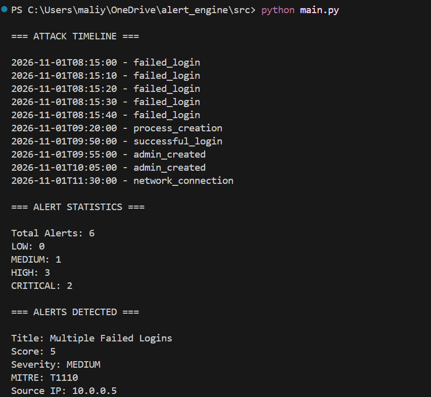
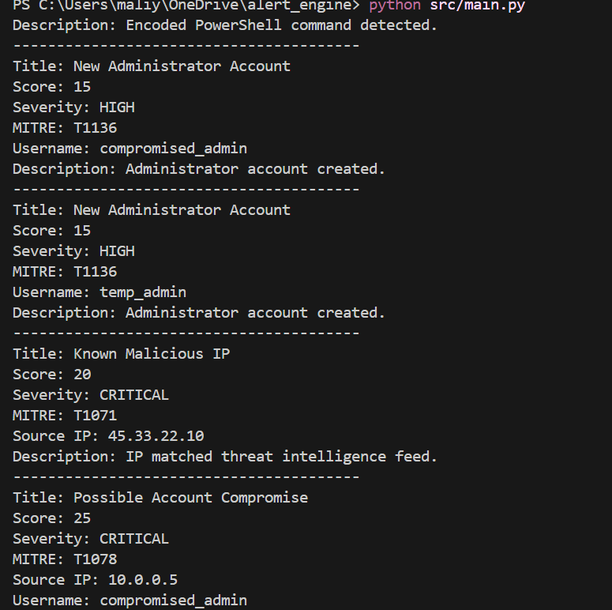
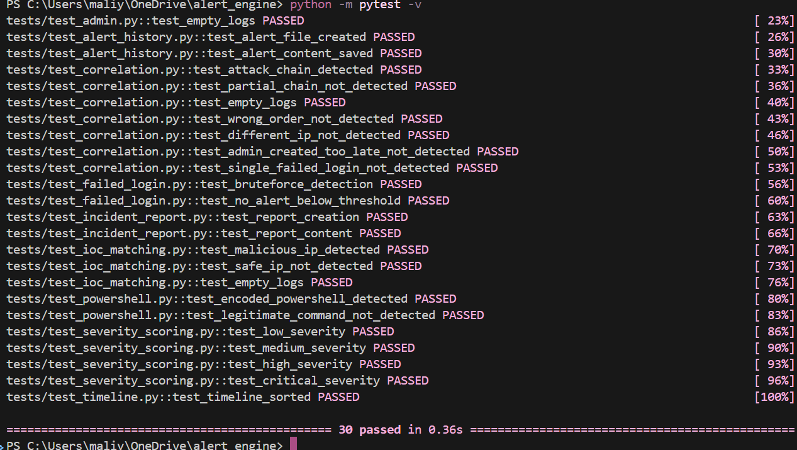
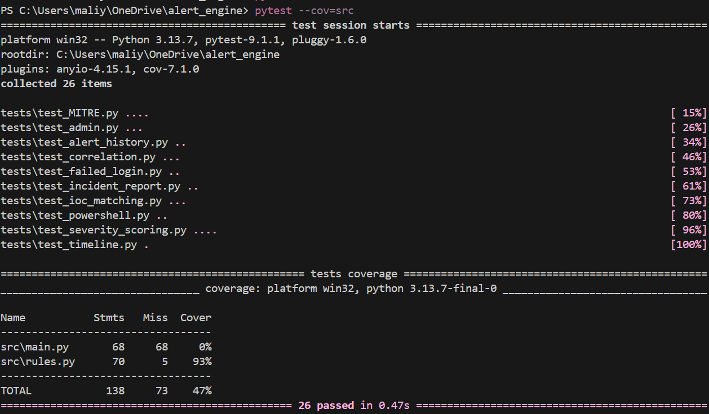

# ThreatHunter Alert Engine

## Overview

ThreatHunter Alert Engine is a Python-based security monitoring tool that analyses log data and identifies suspicious activity using custom detection rules.

The project was built to develop skills in detection engineering, threat hunting and incident response. It processes log events, generates security alerts, maps detections to the MITRE ATT&CK framework and supports basic investigation workflows through attack timelines and incident reporting.

---

## Features

### Detection Rules

- Multiple failed login detection
- Suspicious PowerShell detection
- Administrator account creation detection
- Malicious IP detection using IOC matching

### Threat Hunting

- MITRE ATT&CK mapping
- Alert severity scoring
- Attack chain correlation
- Compromise detection

### Investigation Features

- Attack timeline generation
- Alert history tracking
- Incident report generation
- Alert statistics

---

## Project Structure

```text
alert_engine/
│
├── src/
│   ├── main.py                 # Runs the engine and writes the outputs
│   ├── rules.py                # Detection rules, correlation, timeline and statistics
│   ├── sample_logs.json        # Sample security events
│   ├── alerts.json             # Generated when the engine runs (not uploaded)
│   └── incident_report.txt     # Generated when the engine runs (not uploaded)
│
├── tests/                      # Unit tests for every detection and output
├── Screenshots/
├── requirements.txt
└── README.md
```

---

## Detection Workflow

```text
Log Data
    ↓
Detection Rules
    ↓
Alert Generation
    ↓
MITRE Mapping
    ↓
Severity Scoring
    ↓
Attack Correlation
    ↓
Timeline Generation
    ↓
Incident Report
```

---

## Detection Rules Implemented

### Brute Force Detection

Detects repeated failed login attempts originating from the same IP address.

Example:

```text
Multiple Failed Logins
Severity: MEDIUM
MITRE: T1110
```

---

### Suspicious PowerShell Detection

Detects encoded PowerShell commands that may indicate malicious execution.

Example:

```text
Suspicious PowerShell Activity
Severity: HIGH
MITRE: T1059
```

---

### Administrator Account Creation

Detects creation of administrator accounts which may indicate persistence or privilege escalation.

Example:

```text
New Administrator Account
Severity: HIGH
MITRE: T1136
```

---

### IOC Matching

Matches source IP addresses against a list of known malicious indicators.

Example:

```text
Known Malicious IP
Severity: CRITICAL
MITRE: T1071
```

---

## Attack Correlation

The engine can correlate multiple events into a single security incident.

Example attack path:

```text
Several Failed Logins (same IP)
↓
Successful Login (same IP)
↓
Administrator Account Creation (within 60 minutes)
```

To avoid false alarms, the alert is only raised when:

- At least 3 failed logins come from the same IP address
- The successful login comes from that same IP, after the failed attempts
- An administrator account is created within 60 minutes of the successful login

This means normal activity, such as one mistyped password or an administrator account created earlier in the day, is not flagged as a compromise.

Generated Alert:

```text
Possible Account Compromise
Severity: CRITICAL
MITRE: T1078
```

---

## Timeline Generation

The engine automatically creates a chronological timeline to support investigations.

Example:

```text
2026-11-01T08:15:00 - failed_login
2026-11-01T09:20:00 - process_creation
2026-11-01T09:50:00 - successful_login
2026-11-01T09:55:00 - admin_created
```

---

## Incident Reporting

The project generates:

### alerts.json

Stores all generated security alerts.

### incident_report.txt

Summarises:

- Total alerts
- Critical alerts
- MITRE ATT&CK techniques observed

Example:

```text
=== INCIDENT REPORT ===

Total Alerts: 6

Critical Alerts:
- Known Malicious IP
- Possible Account Compromise
```

---

## Running The Project

Clone the repository:

```bash
git clone https://github.com/mangle-fnaf/alert_engine.git
cd alert_engine
```

Run the alert engine (no extra packages are needed):

```bash
python src/main.py
```

The engine reads `src/sample_logs.json` and saves `alerts.json` and `incident_report.txt` in the `src` folder.

Run the tests from the main project folder:

```bash
pip install -r requirements.txt
python -m pytest -v
```

Run the tests with coverage:

```bash
python -m pytest --cov=src --cov-report=term-missing
```

---

## Screenshots

### Running the engine





### Tests and coverage





---

## Skills Demonstrated

- Python Development
- Log Analysis
- Detection Engineering
- Threat Hunting
- MITRE ATT&CK Mapping
- Incident Response
- Security Automation
- Unit Testing

---

## Limitations

- The malicious IP list is hard-coded in `rules.py` rather than loaded from a live threat intelligence feed.
- Logs are read from a JSON file in batches rather than monitored in real time.
- Failed login detection counts attempts across the whole log rather than within a time window.

---

## Future Improvements

- Threat intelligence API integration
- Sigma rule support
- Real-time log ingestion
- Web dashboard
- Case management
- ThreatHunter SIEM integration